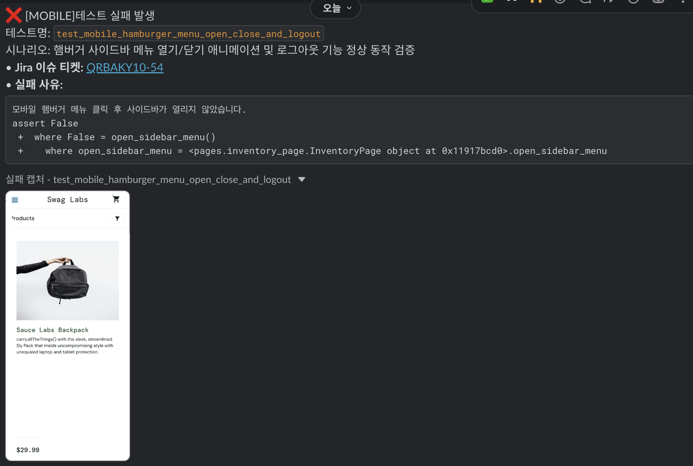
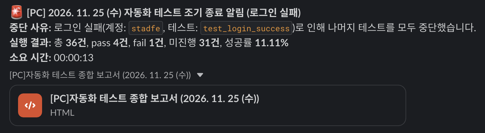
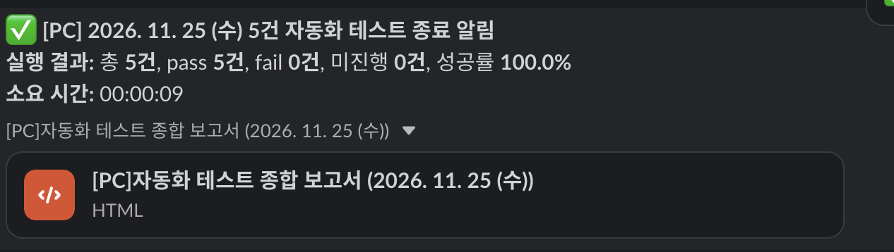
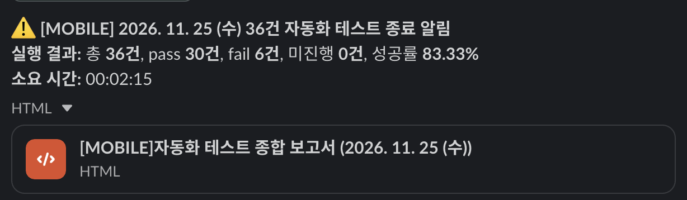
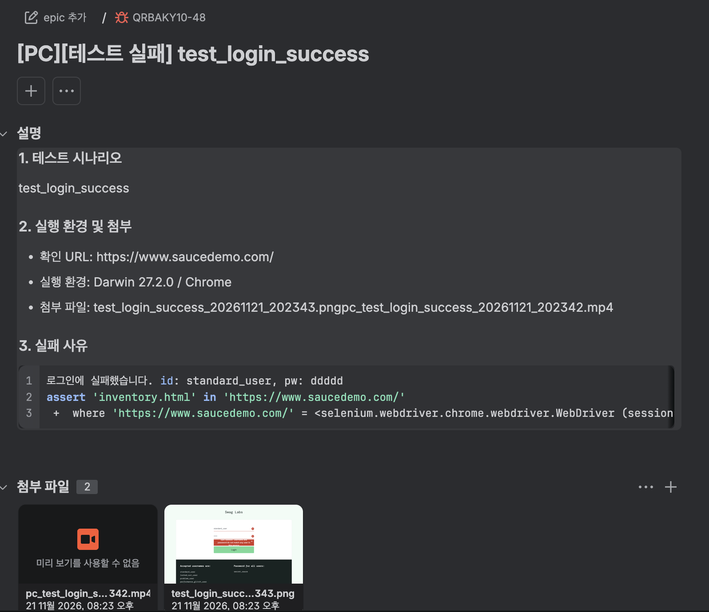
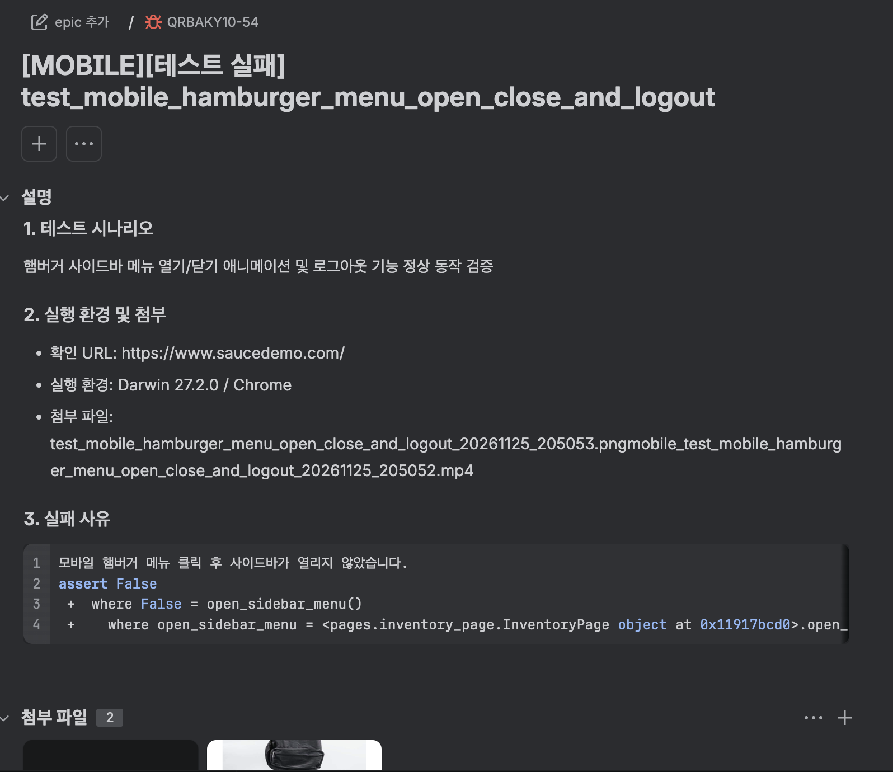
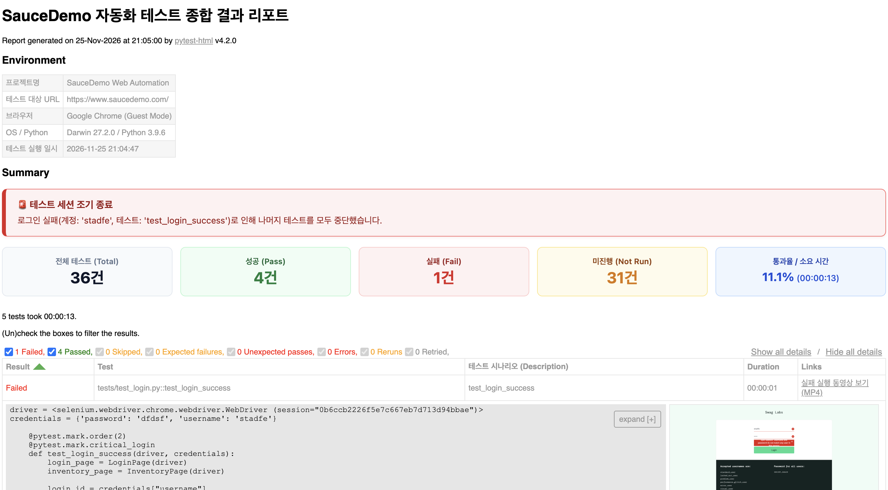
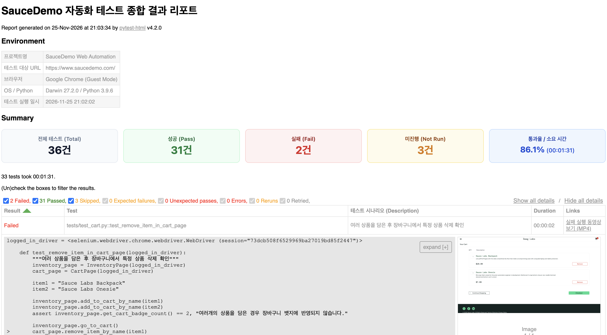

# SauceDemo Web Test Automation

Python, Selenium, Pytest 기반의 **웹 테스트 자동화**입니다.  
**Mobile Web / PC Web 환경 순차 실행**, **실행 우선순위 제어 및 필수 로그인 실패 시 조기 중단**, **CLI 동적 계정 바인딩**, **실패 스크린샷 / 동영상 자동 저장 및 예외 가독성 처리**, **종합 HTML 리포트 Slack / Jira 연동**을 구현했습니다.

## 주요 기능

### 1. Mobile & PC 플랫폼 순차 실행 (`run_tests.py`)
* **모바일 환경 지원:** Chrome mobileEmulation (iPhone 14 Pro 뷰포트 `393x852` 및 모바일 User-Agent)과 PC Web(`1920x1080`) 환경을 분리하여 실행합니다.
* **순차 실행:** `run_tests.py` 실행 시 **1순위 Mobile 환경 실행 및 리포트 / Slack 완료 -> 2순위 PC 환경 실행 및 리포트/Slack 완료** 순으로 동작하고, 전달된 CLI 인자(`--slack`, `--user-id` 등)를 Mobile 환경, PC 환경에서 동일하게 사용합니다.
* **모바일 전용 반응형 검증 (`@pytest.mark.mobile_only`):** 모바일 뷰포트에서의 가로 스크롤 미발생, 상단 헤더 UI 겹침, 햄버거 사이드바 메뉴 미노출을 검증하고 PC 실행 시에는 자동으로 건너뛰기 처리됩니다.

### 2. 실행 우선순위 제어 및 필수 로그인 실패 시 조기 중단
* **계층적 실행 순서 (`pytest-order`):**
  * **1순위 :** 로그인 실패 케이스(입력값 누락, 불일치 계정 등) 우선 검증
  * **2순위 :** 실제 후속 테스트에 사용될 계정의 정상 로그인 검증
  * **3순위 이후:** 1·2순위 통과 후 상품 목록, 장바구니, 결제, 반응형 UI 등 시나리오 진행
* **테스트 조기 종료 (`session.shouldstop`):** 2순위 필수 로그인 테스트가 실패하면 후속 테스트 실행을 즉시 중단하여 시간과 자원를 절약합니다. 중단 시에도 실패 스크린샷 / 영상 저장, Jira 이슈 등록, HTML 리포트 생성 및 Slack 조기 종료 알림까지 모든 기능은 동작합니다.

### 3. CLI 동적 계정 바인딩 (`--user-id`, `--user-pw`)
* 터미널 실행 옵션(`-U` / `--user-id`, `-P` / `--user-pw`)을 통해 테스트 계정을 동적으로 주입할 수 있습니다.
* 옵션을 입력하지 않거나 생략하면 자동으로 기본 계정(`STANDARD_USER` / `PASSWORD`)이 적용되며, `logged_in_driver`를 사용하는 모든 기능 테스트에 반영됩니다.

### 4. 실패 스크린샷 / 동영상 자동 저장 및 예외 가독성 처리
* **브라우저 화면 녹화 (`BrowserVideoRecorder`):** OpenCV와 확장된 Selenium 연결 풀(`ClientConfig`)을 활용해 테스트 과정을 동영상으로 기록합니다. **성공 시 자동 삭제**, **실패 시에만 스크린샷과 동영상을 저장**합니다.
* **Selenium 주요 예외 처리**
  * `TimeoutException`, `NoSuchElementException` 발생 시 메모리 주소나 스택 대신 **대기 시간, 대상 요소, 테스트 페이지 URL**등으로 변환합니다.

### 5. 종합 HTML 리포트 Slack / Jira 연동 - [미리보기](#리포트-및-알림)
* **종합 HTML 보고서:** 상단에 **조기 중단 발생 시 조기 중단 경고 배너**와 **총 테스트(Total), 성공(Pass), 실패(Fail), 미진행(Not Run), 통과율 및 소요 시간(`hh:mm:ss`)**을 기재합니다.
* **Jira Cloud API 연동:** 테스트 실패 시 `[PLATFORM] [자동화 실패] 테스트명` 제목과 이슈 티켓의 본문(시나리오, 환경 정보, 정제된 실패 사유 코드 블록)으로 버그 티켓을 자동 생성하고, **스크린샷과 실행 영상을 티켓에 자동 첨부**합니다.
* **Slack 실시간 알림**
  * **시작 알림:** 플랫폼 라벨(`[MOBILE]`/`[PC]`), 실행 날짜 및 총 테스트 건수 안내
  * **실패 알림:** 실패 스크린샷 이미지, 시나리오, 실패 사유, **생성된 Jira 이슈 링크** 전송
  * **종료 / 조기 종료 알림:** 정상 완료 시 `✅`/`⚠️`, 로그인 실패 조기 중단 시 **`🚨 조기 종료 알림` 및 중단 사유**와 함께 미진행 건수 / 소요 시간 / 최종 HTML 보고서 파일을 업로드합니다.


## 폴더 구조
```text
auto_qa/
├── config/
│   └── config.py                  # .env 및 OS 환경 변수 로드, 필수 설정
├── pages/                         # POM 구조
│   ├── __init__.py
│   ├── base_page.py               # 공통 대기/클릭/입력 및 예외 가독성 처리
│   ├── cart_page.py               # 장바구니 페이지 객체
│   ├── checkout_step_one_page.py  # 배송 정보 입력 및 입력값 검증
│   ├── checkout_step_two_page.py  # 주문 요약 및 금액 계산 검증
│   ├── checkout_complete_page.py  # 주문 완료 페이지 객체
│   ├── dynamic_catalog_page.py    # lazy, spinner, slider 케이스 검증
│   ├── inventory_detail_page.py   # 상품 상제 페이지 검증
│   ├── inventory_page.py          # 상품 목록, 정렬, 장바구니 담기 / 제거, 모바일 사이드바 검증
│   └── login_page.py              # 로그인 페이지 객체
├── tests/                         # 기능 및 시나리오별 테스트
│   ├── __init__.py
│   ├── test_cart.py               # 장바구니 기능 테스트
│   ├── test_checkout.py           # 결제 완주 및 결제 폼 입력 테스트
│   ├── test_dynamic_catalog.py    # lazy, spinner, slider 테스트
│   ├── test_inventory.py          # 상품 정렬, 썸네일 비교, Remove 버튼 테스트
│   ├── test_inventory_sort.py     # 상품 상세 페이지 기능 테스트
│   ├── test_login.py              # [1순위] 로그인 실패 케이스 & [2순위] 필수 로그인 테스트
│   ├── test_logout.py             # 로그아웃 기능, 로그아웃 후 URL로 접근 불가 확인 테스트
│   ├── test_mobile_responsive.py  # [Mobile 전용] 반응형 레이아웃(가로 스크롤/헤더 겹침/사이드바) 테스트
│   └── test_silder.py             # 햄버거 버튼으로 전체 메뉴 노출 및 숨김 테스트
├── utils/                         # 유틸리티 및 외부 시스템 연동 모듈
│   ├── jira_notifier.py           # Jira REST API 이슈 생성 및 증적 파일 첨부
│   ├── slack_notifier.py          # Slack SDK 기반 시작/실패/종료(조기종료) 알림 및 리포트 업로드
│   ├── video_recorder.py          # OpenCV 기반 브라우저 화면 MP4 녹화
├── reports/                       # 테스트 실행 결과물 
│   ├── logs/                      # 실행별 .log 파일
│   ├── screenshots/               # 실패 시 캡처된 .png 파일
│   └── videos/                    # 실패 시 저장된 .mp4 파일
├── .env.example                   # 환경 변수 템플릿 파일
├── .gitignore                     # 민감한 정보(.env), 가상환경(.venv), 리포트 산출물 제외 설정
├── conftest.py                    # Pytest 훅(리포트 요약/배너, 예외 정제, 조기종료, 드라이버, Slack/Jira)
├── pytest.ini                     # Pytest 기본 옵션, 로그 포맷, 커스텀 마커(mobile_only, critical_login)
├── readme.md
├── requirements.txt               # 프로젝트 의존성 패키지 목록
└── run_tests.py                   # Mobile -> PC 순차 실행 통합 테스트 설정 파일

```

## 기술 스택
* 언어 : Python 3.10+
* 웹 자동화 : Selenium WebDriver (`ClientConfig`, Chrome `mobileEmulation`)
* 테스트 프레임워크 : Pytest
   *   pytest-html, pytest-metadata, pytest-order
* 동영상, 스크린샷 : OpenCV, Pillow, Numpy
* 이슈 통합 관리 : Slack SDK, Jira Cloud Rest API
* 환경 : Ubuntu CLI, Windows, Mac OS

## 설치 및 환경 설정
1. 저장소 클론 및 가상환경 생성
``` Bash
git clone https://github.com/bang10/auto_qa.git
cd auto_qa

# 가상환경 생성 및 활성화 (Ubuntu / Mac OS)
python3 -m venv .venv
source .venv/bin/activate

# 패키지 설치
pip3 install --upgrade pip
pip3 install -r requirements.txt
```
2. Ubuntu CLI 환경 추가 패키지 설치
``` Bash
wget -q -O /tmp/google-chrome-stable_current_amd64.deb https://dl.google.com/linux/direct/google-chrome-stable_current_amd64.deb
sudo apt update && sudo apt install -y /tmp/google-chrome-stable_current_amd64.deb libgl1 libglib2.0-0
rm /tmp/google-chrome-stable_current_amd64.deb
```
3. 환경 변수 설정
``` Bash
# .env.example 파일을 복사하여 .env 파일을 생성한 뒤 실제 계정 및 토큰 정보를 입력합니다.
cp .env.example .env
```

## 실행 방법
1. Moblie -> PC 전체 순차 실행
- Mobile 환경 완료 후 PC 환경 테스트를 기본 계정으로 진행합니다.
``` bash
# --slack 옵션 제거 시 슬랙 알람 비활성화로 실행
# --jira 옵션 제거 시 jira 이슈 티켓 미생성
python3 run_tests.py --slack --jira
```
2. 특정 계정 지정 실행
- 계정 옵션을 입력하지 않으면 기본값(`STANDARD_USER`, `PASSWORD`)이 자동 적용됩니다.
``` bash
# 특정 계정 ID만 지정 실행 (비밀번호는 기본값 자동 적용)
python3 run_tests.py --slack --user-id=problem_user

# 단축 옵션(-U, -P)으로 ID/PW 모두 직접 지정
python3 -m pytest --platform=pc --slack -U visual_user -P secret_sauce
python3 -m pytest --platform=mobile --slack --jira --user-id locked_out_user --user-pw password
```
3. 플랫폼 단독 실행
``` bash
# Moblie 환경만 실행
python3 -m pytest --platform=mobile

# PC 환경만 실행
python3 -m pytest --platform=pc
```
4. 특정 테스트만 실행
``` bash
# 특정 파일의 테스트만 실행
python3 -m pytest tests/(파일 경로)

# 특정 파일의 특정 테스트만 실행
python3 -m pytest tests/(파일 경로)::(함수 이름)
```
5. Ubuntu에서 CLI 환경 실행
``` bash
HEADLESSS=true python3 run_test.py
HEADLESSS=true python3 -m pytest
```

## 리포트 및 알림
### Slack 알림
  *   시작 알림
  *   실패 시 캡처 화면, 요약, Jira 티켓 링크 전송
  *   정상 종료 또는 조기 종료 결과 및 보고서 파일 첨부

| **테스트 시작 알림** | **실패 발생 및 Jira 티켓 링크** |
| :---: | :---: |
|  |  |
| **로그인 실패 시 조기 종료 알림** | **테스트 종료 알림 (실패 없음)** |
|  |  |
| **테스트 종료 알림 (실패 존재)** | |
|  | |

### Jira 이슈 생성 : `[platform] [테스트 실패] <테스트명>` 
  *   테스트 시나리오, 실행 환경, 실패 사유 및 첨부 파일 (스크린 샷, 동영상) 자동 등록

| **PC 환경 이슈** | **Mobile 환경 이슈** |
| :---: | :---: |
|  |  |

### 종합 HTML 보고서 : `report_<platform>_YYYYMMDD_HHMMSS.html`
  *   상단 요약 카드(총 건수 / Pass / Fail / 미진행 / 통과율·소요시간) 및 필수 로그인 실패 시 테스트 세션 조기 종료 경고 배너 표시
  *   실패 케이스인 경우 스크린 샷 및 동영상 링크 기재

| **조기 종료 리포트** | **종료 리포트** |
| :---: | :---: |
|  |  |
